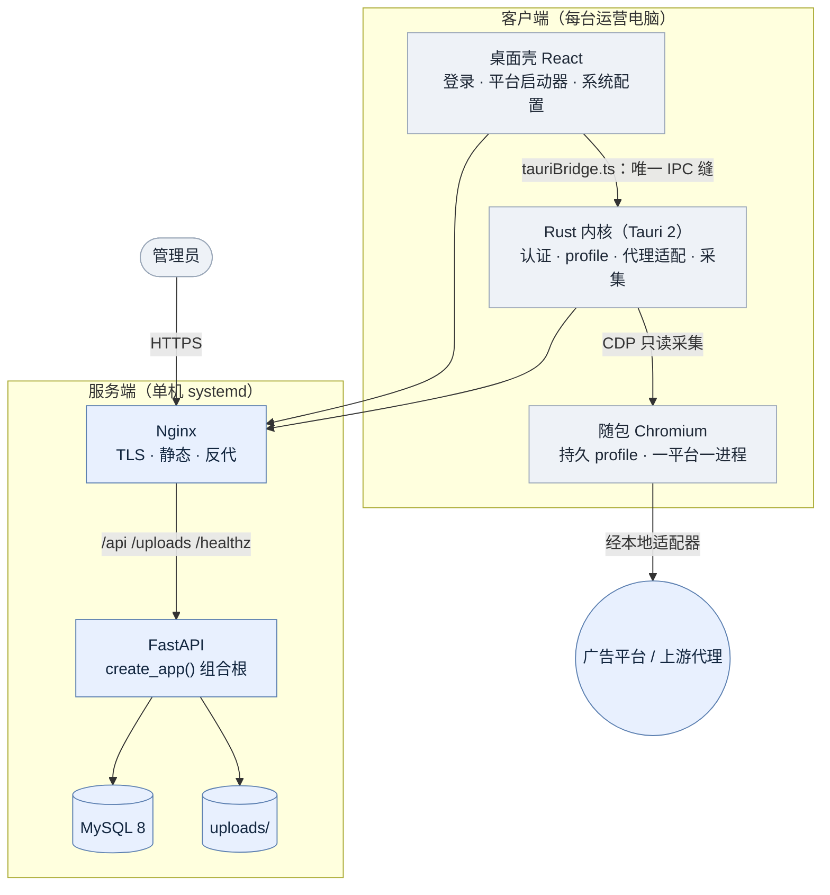

# Vestus

**带认证的受控浏览器。** 广告代理公司把平台操作权收归管理员，运营人员在受控、隔离、可审计的独立
Chromium 环境里操作巨量引擎等广告平台。

[架构与流程图集](docs/architecture.md) · [接口与环境变量](docs/backend.md) ·
[Linux 部署](docs/deploy-linux.md) · [桌面用户手册](docs/desktop-user-guide.md)

## 目录

- [它解决什么问题](#它解决什么问题)
- [核心能力](#核心能力)
- [架构](#架构)
- [仓库结构](#仓库结构)
- [快速开始](#快速开始)
- [配置](#配置)
- [构建与发布](#构建与发布)
- [测试与质量门禁](#测试与质量门禁)
- [关键行为与安全边界](#关键行为与安全边界)
- [文档索引](#文档索引)

## 它解决什么问题

| 问题 | Vestus 的做法 |
| --- | --- |
| 平台账号密码散落在每个运营手里，人走了账号还在 | 凭据由超管在后台统一保管，桌面端拿到的是受控会话，用户看不到也不输入平台密码 |
| 一批运营共用一条代理线路，出口混乱、无法追责 | 每条线路绑定到具体用户，流量经本地适配器按清单分流，出口 IP 在管理端可查 |
| 谁在什么时间访问了哪个页面，事后查不到 | 浏览器活动按「用户 × 设备 × 平台 × 自然日」采集与汇总，只采地址与操作次数 |
| 换台电脑就得重新登录，且说不清是不是同一台设备 | 每个平台一套持久 profile，机器标识随会话上报，支持跨账号追溯同一设备 |

## 核心能力

| 域 | 能力 |
| --- | --- |
| 身份 | 管理员与桌面用户两套认证；桌面用户归属到管理员，普通管理员只看自己名下数据，越界一律 404 |
| 受控环境 | 持久 profile（服务器 × 账号 × 平台 × 代理/直连 四维隔离）、单例锁协调、按账号重置、一平台一进程 |
| 出站治理 | 代理凭据只在服务端与 Rust 内存；本地适配器按「直连域名清单」分流，两条路径互不回退 |
| 托管登录 | 超管替用户保管平台凭据，一次性票据引导已登录会话；失效时后台自动恢复，遇验证码/MFA 转人工 |
| 可观测 | 页面地址与操作计数采集（不含标题、元素、按键、敏感字段）；会话明细、按天汇总、审计日志 |
| 交付 | Windows / macOS（arm64、x86_64）/ Linux 四目标安装包，随包锁定版 Chromium |

## 架构



一张图的读法：**管理员在管理端配置用户/代理/平台 → 桌面端登录后拉取属于自己的那份配置 →
打开平台时 Rust 起一个随包 Chromium，流量经本地适配器分流 → 页面活动经 DevTools 协议采集后
批量上报，管理端在「会话追踪」查看明细与按天汇总。**

三条边界的意义：

1. **桌面端是唯一同时接触用户、浏览器与外网的一方**。后端不驱动浏览器，也不持有会话 Cookie。
2. **代理凭据只存在于服务端数据库与 Rust 进程内存**，不进 React、不进代理 URL、不落本地配置文件。
3. **客户端不做页面自动化**。页面由用户自己操作，采集只读。

完整图集（上下文图、后端分层、四条关键时序、数据模型、部署拓扑、发布流水线）见
[docs/architecture.md](docs/architecture.md)。

### 组成

| 部分 | 技术 | 给谁用 | 职责 |
| --- | --- | --- | --- |
| 后端 | Python 3.11 + FastAPI + SQLAlchemy + MySQL | 两端共用 | 统一 API（`{code, msg, data}` 信封）、两套认证、配置下发、活动接收与查询、文件上传 |
| 管理端 | React + TypeScript + Tailwind + shadcn-ui | 管理员 | 用户与绑定、代理节点、平台入口、托管账号、会话追踪、审计日志 |
| 桌面端 | React 壳 + Rust（Tauri 2）+ 随包 Chromium | 桌面用户 | 登录、代理适配、打开平台浏览器、采集并上报页面活动 |

后端严格单向分层 `api → services → repositories → db`，`schemas` 作为共享 DTO 不在垂直链上，
`core` 在最底部。规则由 [.importlinter](.importlinter) 的 6 条契约在 CI 里断言：**只有 services
提交事务**，repositories 只做查询与写入，api 只做认证、参数解析与响应封装。

## 仓库结构

```
.
├── app/                后端应用包（入口 uvicorn app.main:app）
│   ├── api/            HTTP 层：deps.py 依赖注入 · envelope.py 响应信封 · routers/ 路由
│   ├── services/       业务用例与事务边界（含 serializers.py：ORM → 响应字典的唯一真源）
│   ├── repositories/   纯查询与写入，不提交事务
│   ├── schemas/        Pydantic 契约；上报模型在此执行采集边界（脱敏、丢超限快照）
│   ├── db/             SQLAlchemy 模型与会话工厂（MySQL 生产 / SQLite 测试）
│   └── core/           配置、口令与令牌、设备标识归一化、中间件、上传存储
├── migrations/         Alembic 迁移（0001_baseline 对应现网表结构）
├── scripts/init_db.py  建表/迁移 + 引导首个管理员（空库、受管库、迁移前库三类都能安全执行）
├── tests/              后端测试（临时 SQLite，不连生产 MySQL）
├── web/                管理端前端（React + Vite）；构建产物 web/dist 由后端 /admin 托管
├── desktop/            桌面端
│   ├── src/            React 壳：components/{auth,browser,settings} · services/tauriBridge.ts
│   ├── src-tauri/      Rust 内核（模块职责见 docs/architecture.md#5-桌面端运行时拓扑）
│   └── scripts/        边界检查、随包 Chromium 准备、发布版本号写入
├── deploy/             systemd 单元、Nginx 配置模板（合并/拆分两种）、MySQL 迁移
├── docs/               架构图集、接口、部署、桌面手册；design/ 设计方案，archive/ 已归档文档
└── .scratch/           需求与实施记录：一个功能一个目录，spec.md + issues/NN-*.md
```

本地如需保留 `oa/`、`ad_browser/` 参考项目，可放在仓库根目录；两者均被 Git 忽略，
不参与构建或发布。

## 快速开始

前置：Python 3.11+、Node.js 20+、Rust 1.77+（仅桌面端）、MySQL 8（本地可用
`docker-compose.mysql.yml`）。

### 1. 后端

```bash
python3 -m pip install -r requirements.txt
cp .env.example .env
# .env 必须填真实的 VESTUS_SECRET_KEY（≥32 字符），否则服务拒绝启动
python3 scripts/init_db.py
uvicorn app.main:app --reload --host 127.0.0.1 --port 8000
```

### 2. 管理端

```bash
cd web
npm install
npm run dev          # 开发服务器；生产构建见「构建与发布」
```

访问 `http://127.0.0.1:5174`。后端构建好 `web/dist` 后也可直接访问 `http://127.0.0.1:8000/admin`。

### 3. 桌面端

```bash
cd desktop
npm install
node scripts/prepare-chromium.mjs   # 铺好随包 Chromium（只需跑一次）
npm run desktop:dev
```

`npm run desktop:dev` 会把 `VESTUS_CHROMIUM_PATH` 指向 `desktop/src-tauri/resources/chromium/`；
显式设置该变量则用你指定的；两者都没有时 macOS 回退到系统 Chrome。

> **为什么不指向 `target/debug/chromium/`**：`tauri dev` 的那次复制是原地覆盖，覆盖到正在运行的
> Chromium 会让内核记下对不上的代码签名，之后该路径每次启动都被 `SIGKILL (Code Signature
> Invalid)` 直接杀掉，只能删目录重铺。理由写在 `scripts/tauri-with-api.mjs:devChromiumOverride`。

### 4. 首次使用顺序

1. 访问 `/admin`，用 `scripts/init_db.py` 引导的超管账号登录。
2. 创建代理节点（配直连域名清单）与平台入口，启用要下发给全体桌面用户的项。
3. 创建桌面用户，绑定归属管理员；如需托管登录，再为其绑定平台账号。
4. 在桌面端用该用户登录 → 同步配置 → 打开平台。

管理端重置的临时密码必须先在本机改掉，之后才会下发配置。

## 配置

环境变量完整说明见 [docs/backend.md](docs/backend.md#启动)。必填与常改项：

| 变量 | 说明 |
| --- | --- |
| `VESTUS_DATABASE_URL` | 数据库地址（MySQL；测试用 SQLite） |
| `VESTUS_SECRET_KEY` | 令牌签名密钥，≥32 字符，缺失则拒绝启动 |
| `VESTUS_PROXY_SECRET_KEY` | 代理口令加密密钥，与上一个**必须不同** |
| `VESTUS_PLATFORM_SECRET_KEY` | 平台凭据加密密钥，与上面两个**必须不同** |
| `VESTUS_BOOTSTRAP_ADMIN_USERNAME` / `_PASSWORD` | 仅首次初始化使用，创建管理员后应删除并重启 |
| `VESTUS_ACCESS_TOKEN_TTL_SECONDS` | 访问令牌有效期，默认 900 |
| `VESTUS_CORS_ORIGINS` | 允许的来源，开发环境为 `localhost:5174` |
| `VESTUS_UPLOAD_DIR` / `_MAX_BYTES` | 上传根目录与单次上限（默认 10 MiB） |
| `VESTUS_MANAGED_RECOVERY_ENABLED` | 是否启用托管会话恢复后台线程 |
| `VESTUS_MANAGED_CHROMIUM_PATH` | 服务端登录 Worker 使用的 Chrome/Chromium 路径；Cookie 导入模式可不配 |

桌面端构建期还需 `VESTUS_API_BASE_URL`，正式发布要求 HTTPS。

## 构建与发布

正式发布覆盖四个目标：Windows x86_64（NSIS `.exe`）、macOS arm64 与 x86_64（`.dmg`）、
Linux x86_64（`.deb` / `.AppImage`）。随包 Chromium 不能跨平台也不能跨架构，因此每个目标都在
对应 GitHub runner 上原生构建，构建时下载锁定版本（Playwright 1.63.0）的浏览器资源并打进安装包。

`.github/workflows/release.yml` 的三种用法：

| 触发 | 行为 |
| --- | --- |
| 推送 `desktop-v1.2.3` 标签 | 四平台全部成功后自动创建 GitHub Release 并挂包；标签版本号写入 `tauri.conf.json` |
| 手工运行 `Release` | 只构建不发版，产物在该次 Actions 的 Artifacts（保留 14 天）；可填 `api_base_url` 覆盖后端地址 |
| 缺 `VESTUS_API_BASE_URL` 或使用 HTTP | 构建直接失败，不发布不可登录或明文传输凭据的包 |

本地复现某个平台的发布包（在对应操作系统上执行）：

```bash
cd desktop
npm ci
node scripts/prepare-chromium.mjs
VESTUS_API_BASE_URL='https://api.example.com' npm run desktop:build
```

平台差异：macOS 包未做 Apple 签名与公证（ad-hoc 签名），首次打开需右键 →「打开」；Linux 未启用
系统钥匙串后端，登录状态只在应用运行期间保留，重启客户端要重新登录。

## 测试与质量门禁

```bash
make check                           # ruff → mypy → import-linter → pytest，与 CI 同序

# 分项执行
python3 -m pytest -q tests
python3 -m ruff check .
python3 -m mypy
lint-imports                         # 校验后端分层契约

cd web       && npm run build
cd desktop   && npm test && npm run build && npm run check:surfaces
cd desktop/src-tauri && cargo test --all-targets
```

`npm run check:surfaces` 静态守护桌面端的两条边界：React 不得越过 `tauriBridge.ts` 触达内核、
采集连接必须只读。

真实浏览器持久化另行验收：在 `desktop/` 执行 `npm run test:persistence`，用随包 Chromium 验证
Cookie、站点存储、关闭重启、强杀恢复、环境隔离与账号重置。缺浏览器时**失败而不是静默跳过**。
升级/回滚命令与覆盖边界见 [docs/browser-persistence-testing.md](docs/browser-persistence-testing.md)。

## 关键行为与安全边界

### 持久浏览器环境

每个平台在每台电脑上有一套单独保存的 Chromium profile，关掉浏览器后 Cookie 与登录状态保留。
环境按「服务器 × 桌面账号 × 平台 × 代理/直连」四维隔离：同机多账号彼此不可见，同账号多机各存一套、
互不同步。每次冷启动只打开平台入口页——Chromium 的「继续浏览上次打开的网页」受 HMAC 保护关不掉，
所以客户端在启动前清掉上次会话数据，否则会恢复旧标签页并产生用户没打开过的采集记录。重复点击同一
平台会切回已有标签页（页面原样保留）。

环境目录：macOS `~/Library/Application Support/com.zhixi.vestus/browser-profiles/`、
Windows `%LOCALAPPDATA%\com.zhixi.vestus\browser-profiles\`、
Linux `~/.local/share/com.zhixi.vestus/browser-profiles/`。「系统配置 → 浏览器环境」可清除当前
账号在本机的全部环境。详见 [docs/desktop-user-guide.md](docs/desktop-user-guide.md#72-浏览器环境)。

多实例通过系统文件锁协调：每个浏览器持有账号共享锁与平台环境独占锁，重置持有账号独占锁直到删除
结束；锁文件在 profile 根目录 `.locks/`，不随重置删除；锁被占用时立即提示重试，不等待。不同平台
仍可并行。旧版客户端不参与文件锁协调，但启动与重置仍会检查 Chromium 的占用标记。

### 代理与直连

桌面端不提供手工填写代理的入口。代理口令在服务端加密保存，下发后只存在于当前 Rust 会话内存。
代理不可用时本地适配器返回错误，**不会回退到本机直连**。管理员可为每条代理配置「直连域名」清单：
命中直连，未命中一律走代理，两条路径互不回退。直连流量暴露本机真实出口 IP 且不携带代理凭据，
因此只应放入确实需要直连的站点。规则见 [docs/backend.md](docs/backend.md#直连域名bypasshosts)。

### 活动采集边界

采集只包含页面地址（含脱敏后的 query）与操作次数。页面标题、点击元素、按键、凭据与敏感表单字段
一律不进采集范围；输入/提交只保留最近一条字段名快照（值不保存）。上报为增量批次，服务端按
`(user_id, batch_id)` 幂等回执，客户端 outbox 收到确认后才删除本地批次，因此断网、重启、升级都不会
重复入库。边界由 `npm run check:surfaces` 与 `cdp.rs` 单测共同守护。投递细节见
[docs/browser-activity-delivery.md](docs/browser-activity-delivery.md)。

### 托管登录

超管可在用户行内保存平台账号密码或 Cookie，服务端验证后签发一次性票据，客户端先注入再导航，
用户不经过平台登录页。凭据不进 `desktop-config` 通用响应、不进 React、不进活动日志。会话失效时
由 `ManagedRecoveryWorker` 抢租约恢复；遇到验证码、MFA、SSO 或页面结构不匹配则明确转为人工处理，
**不绕过平台风控**。

口径必须说清：本地注入方案只能“隐藏”凭据，不能保证客户完全控制本机时仍拿不到会话——本机
profile、DevTools 或改过的客户端都可以取得。若验收要求“客户即使有技术能力也拿不到会话”，需走
服务端远程浏览器方案，见 [docs/design/2026-11-02-巨量方舟托管登录设计.md](docs/design/2026-11-02-巨量方舟托管登录设计.md)。

### 设备标识

桌面端上报操作系统暴露的机器标识（macOS `IOPlatformUUID`、Windows `MachineGuid`、
Linux `/etc/machine-id`），用于会话归属与审计展示。读取失败或值不合规时上报为空，**采集绝不
影响登录与上报**；老版本客户端不带该字段照常工作。局限：重装系统、换逻辑板、容器重建都会变，
克隆镜像可能重复——只适合审计与告警，不能当安全边界。见 [docs/backend.md](docs/backend.md#设备标识)。

### 文件上传

`POST /api/admin/uploads` 仅管理员可调用，请求体上限为 `VESTUS_UPLOAD_MAX_BYTES + 65536` 字节；
`GET /uploads/{file_path}` 公开读取。数据库只存 `/uploads/YYYY/MM/<uuid>.<ext>` 相对路径，完整 URL
按请求 `Host` 生成。系统 Logo 与平台图标只允许引用本系统已上传的图片格式。

### 本地端口

本地代理只监听随机的 `127.0.0.1` 端口，可隔离局域网访问，但同机其他进程理论上仍可能探测并使用
该端口。若部署环境把同机恶意进程纳入威胁模型，还需补充操作系统级进程隔离。

## 文档索引

先看这三份就够上手：根目录本文件、[docs/architecture.md](docs/architecture.md)、[docs/backend.md](docs/backend.md)。

| 文档 | 内容 |
| --- | --- |
| [docs/architecture.md](docs/architecture.md) | 架构图集：上下文、容器、分层、四条关键时序、数据模型、部署拓扑、发布流水线 |
| [docs/design/2026-11-04-Vestus整体架构设计.md](docs/design/2026-11-04-Vestus整体架构设计.md) | 深模块方法论下的分层与缝的论证、演进方向、明确不做的事 |
| [docs/backend.md](docs/backend.md) | 环境变量、接口概览、表清单、桌面配置与可见范围、迁移 |
| [docs/deploy-linux.md](docs/deploy-linux.md) | Linux 生产部署：systemd、Nginx、备份与恢复 |
| [docs/desktop-user-guide.md](docs/desktop-user-guide.md) | 面向运营人员的使用手册 |
| [docs/desktop-ark-auto-login-faq.md](docs/desktop-ark-auto-login-faq.md) | 客户 FAQ 原文；后台内置模板与客户端基线都以它为母本，改文案三处同步 |
| [docs/browser-persistence-testing.md](docs/browser-persistence-testing.md) | 持久化验收：用例、升级与回滚 |
| [docs/managed-session-expiry-testing.md](docs/managed-session-expiry-testing.md) | 托管会话失效探测：不变式、接口约束与回归用例 |
| [docs/browser-activity-delivery.md](docs/browser-activity-delivery.md) | 日志投递可靠性、断网与切账号、新旧客户端更新顺序 |
| [docs/design/](docs/design/) | 托管登录、提示条治理等设计方案（按日期，未实施也在此） |
| [docs/archive/README.md](docs/archive/README.md) | 已归档：三表时代的后台提案、v0.1 内嵌浏览器方案、8/28 审计快照、未启动的自动更新设计 |

需求与实施记录不在这里：按 [docs/agents/issue-tracker.md](docs/agents/issue-tracker.md) 的约定，
一个功能一个目录放在 `.scratch/<feature>/`（`spec.md` + `issues/NN-*.md`）。
