# Vestus 架构与流程图集

> 面向：新加入的开发、需要评审架构的技术负责人、需要交付说明的实施人员。
> 全部图使用 Mermaid 编写，GitHub、VS Code、Typora、Obsidian 均可直接渲染；改代码时顺手改图，
> 图与实现放在同一个 PR 里评审。
> 设计取舍的论证过程见 [Vestus 整体架构设计](design/2026-11-04-Vestus整体架构设计.md)；
> 环境变量与接口细节见 [backend.md](backend.md)。

## 图索引

| # | 图 | 回答的问题 |
| --- | --- | --- |
| 1 | [系统上下文](#1-系统上下文) | 谁在用、系统边界在哪、依赖哪些外部系统 |
| 2 | [容器视图](#2-容器视图) | 有几个可部署单元，各自技术栈与职责 |
| 3 | [后端分层](#3-后端分层与依赖方向) | 一次请求穿过哪些层，哪层能做什么 |
| 4 | [请求生命周期](#4-请求生命周期) | 中间件顺序、事务边界、错误如何收敛成信封 |
| 5 | [桌面端运行时拓扑](#5-桌面端运行时拓扑) | 进程、线程、端口的实际布局 |
| 6 | [登录与配置下发](#6-时序-a登录与配置下发) | 桌面端如何拿到属于自己的一份配置 |
| 7 | [打开平台与出站分流](#7-时序-b打开平台与出站分流) | 流量为什么走代理、什么时候直连 |
| 8 | [活动采集与上报](#8-时序-c活动采集与可靠上报) | 断网、重发、重复批次怎么保证不重不漏 |
| 9 | [托管登录与恢复](#9-时序-d托管登录与失效恢复) | 用户为什么不用输平台账号密码 |
| 10 | [数据模型](#10-数据模型) | 表之间的关系与关键约束 |
| 11 | [部署拓扑](#11-部署拓扑单机) | 生产环境上端口、进程、静态文件怎么放 |
| 12 | [发布流水线](#12-发布流水线) | 一次发版会产出什么，失败条件是什么 |
| 13 | [约束总表](#13-约束总表) | 哪些规则是 CI 强制的，不是文档里的愿望 |

---

## 1. 系统上下文

Vestus 是一套「带认证的受控浏览器」：代理公司把广告平台的操作权限收归到自己的管理员手里，
运营人员在受控环境里操作平台，所有访问留痕。

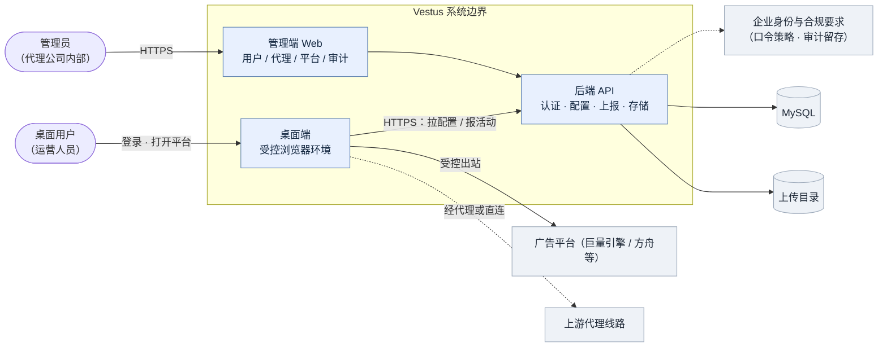

三条必须记住的边界：

1. **桌面端是唯一同时接触「用户、Chromium、外网」的一方**；后端从不直接驱动浏览器，也不持有会话 Cookie。
2. **代理凭据只存在于服务端数据库与 Rust 进程内存**，不进 React、不进代理 URL、不落本地配置文件。
3. **管理端不下发能力给浏览器**：页面不做自动化，用户看到的就是他自己操作的浏览器。

---

## 2. 容器视图

```mermaid
flowchart TB
    subgraph client["客户端（每台运营电脑）"]
        shell["桌面壳 React<br/>登录 / 平台启动器 / 系统配置"]
        rust["Rust 内核（Tauri 2）<br/>认证 · profile · 代理适配 · 采集"]
        chromium["随包 Chromium<br/>持久 profile · 一平台一进程"]
        shell -->|"tauriBridge.ts<br/>唯一 IPC 缝"| rust
        rust -->|"CDP 只读采集 / 一次性控制连接"| chromium
    end

    subgraph server["服务端（单机 systemd）"]
        nginx["Nginx<br/>TLS 终止 · 静态托管 · 反代"]
        fastapi["FastAPI 应用<br/>create_app() 组合根"]
        worker["ManagedRecoveryWorker<br/>托管会话恢复后台线程"]
        db[("MySQL 8")]
        files[("uploads/ 目录")]

        nginx -->|"/api · /uploads · /healthz"| fastapi
        fastapi --> db
        fastapi --> files
        worker --> db
    end

    adminuser(["管理员浏览器"])

    adminuser -->|"HTTPS"| nginx
    shell -->|"HTTPS：admin 令牌"| nginx
    rust -->|"HTTPS：desk 令牌"| nginx
    chromium -->|"经本地适配器出站"| internet(("广告平台 / 上游代理"))

    classDef soft fill:#eef2f7,stroke:#9aa7b8,color:#1f2937
    classDef svc fill:#e8f0fe,stroke:#5b7fb0,color:#12263f
    classDef store fill:#f2f0e6,stroke:#b0a888,color:#2b2a22
    class shell,rust,chromium,adminuser soft
    class nginx,fastapi,worker svc
    class db,files store
```

可部署单元只有两个：**服务端一台机器**（Nginx + Uvicorn + MySQL）与**桌面安装包**。
刻意不做微服务：三端一体，拆分只会增加缝、不增加杠杆。

---

## 3. 后端分层与依赖方向

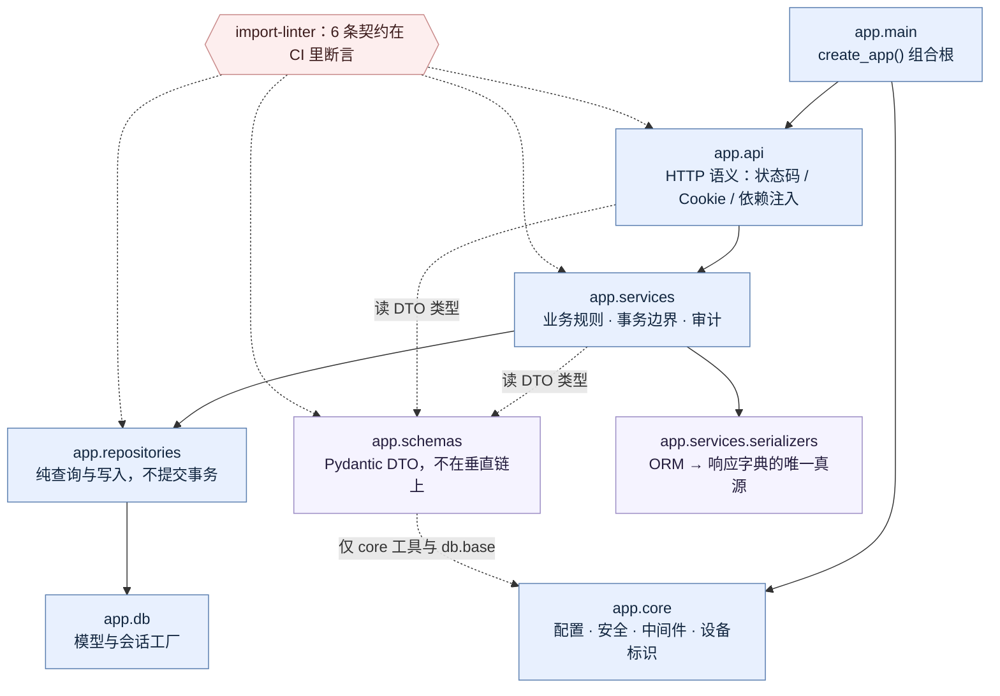

每层都是一条缝，缝上有明确的替换纪律：

| 层 | 允许出现 | 明确禁止 |
| --- | --- | --- |
| `app/api` | HTTP 语义、依赖注入、响应封装 | SQL、业务规则 |
| `app/services` | 业务规则、事务提交、ORM→DTO | `fastapi` / `starlette` |
| `app/repositories` | 查询与写入，返回 ORM 实体 | DTO、业务判断、`commit()` |
| `app/schemas` | 纯 Pydantic 契约 | 任何编排层、ORM 模型 |

`app.core` 在依赖图的最下方，自身不依赖任何项目内模块，因此可以被任意层引用。

---

## 4. 请求生命周期

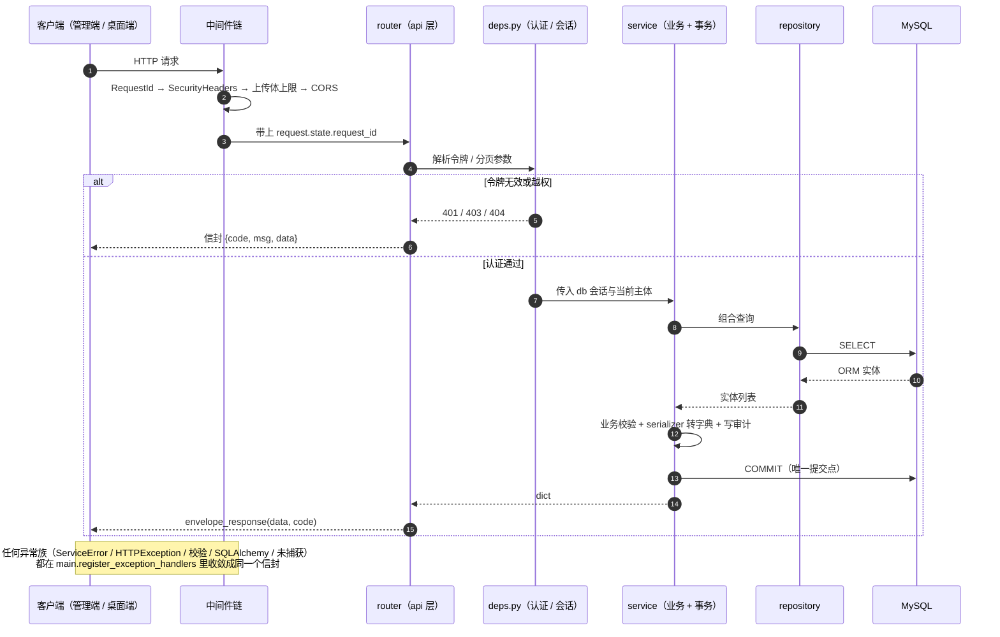

三个细节决定了这套流程的可维护性：

- **`RequestIdMiddleware` 在最外层**：id 必须在任何日志或响应之前就存在，出问题时用它把前端 toast 与后端日志对上。
- **只有 service 提交事务**：repository 里没有 `commit()`，所以一次业务动作的原子边界在代码里唯一可见。
- **错误只有一种形状**：`{code, msg, data}`，`X-Request-Id` 是唯一的排障线索；500 不返回异常原文，避免把连接串带进响应。

---

## 5. 桌面端运行时拓扑

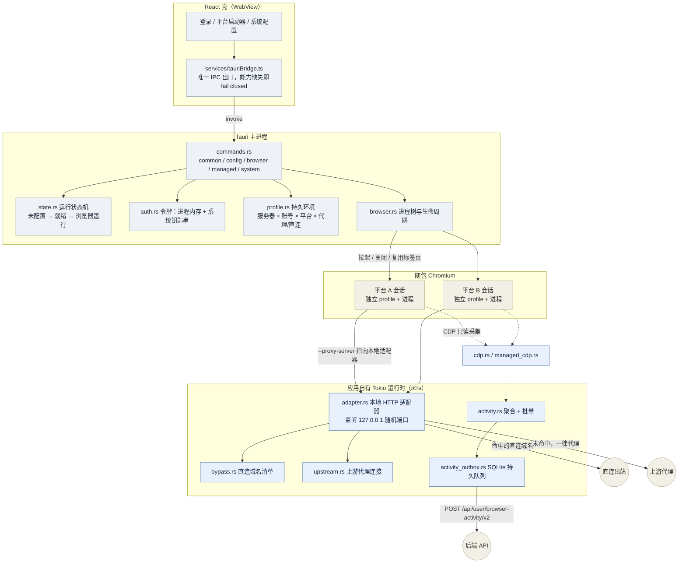

内核模块职责（`desktop/src-tauri/src/`）：

| 模块 | 职责 |
| --- | --- |
| `commands.rs`（拆为 common / config / browser / managed / system） | 暴露给 React 的全部 IPC 命令，唯一 command 面 |
| `rt.rs` | 应用自有 Tokio 运行时：适配器与上报在 Tauri 事件循环之外长驻 |
| `auth.rs` | 登录 / 恢复 / 登出 / 改密；令牌仅存进程与系统钥匙串 |
| `profile.rs` | 持久环境：四维隔离、单例占用检测、残留锁清理、按账号重置 |
| `browser.rs` | Chromium 进程树与生命周期，优雅关闭保 Cookie 落盘 |
| `adapter.rs` / `bypass.rs` / `upstream.rs` | 本地适配器、直连清单匹配、上游代理连接与 Basic 认证 |
| `cdp.rs` / `managed_cdp.rs` | DevTools 协议：只读采集（普通态）与托管登录的一次性控制连接 |
| `activity.rs` / `activity_outbox.rs` | 聚合为固定批次；SQLite 持久队列、原子转批、重启后补报 |
| `state.rs` | 运行状态机与关停顺序 |
| `config.rs` / `device.rs` / `probe.rs` / `httpio.rs` | 下发配置校验、机器标识、出口 IP 探测、最小 HTTP 报文头解析 |

关键约定：

- **一条 IPC 缝**：React 只能经 `tauriBridge.ts` 触达内核，`check-surface-boundaries.mjs` 在 CI 静态拦截。
- **一个环境一个进程**：不同平台并行，同一平台重复点击切回已有标签页，不新开起始页。
- **适配器只监听 `127.0.0.1` 随机端口**：局域网无法访问；但同机进程理论上仍可探测，这被明确写进威胁模型。
- **两条出站路径互不回退**：代理不可用就报错，不会悄悄走本机直连——否则真实出口 IP 会意外泄露。

---

## 6. 时序 A：登录与配置下发

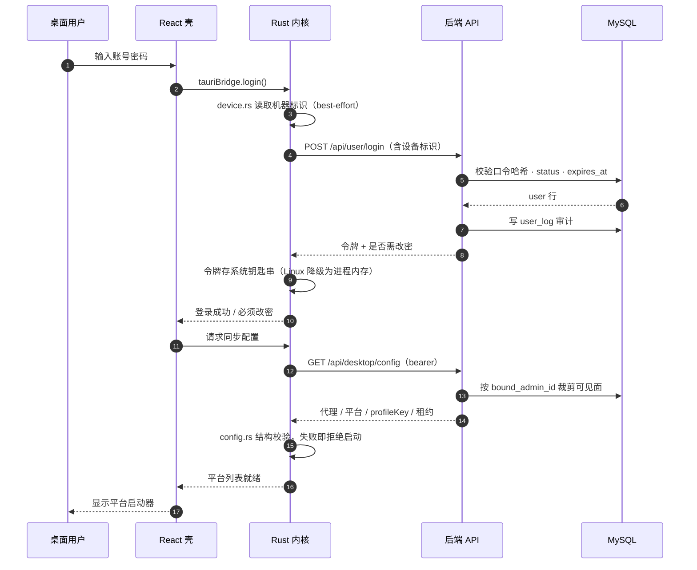

**缝价值**：配置由服务端按归属裁剪，桌面端永远不知道其他用户的存在；管理端重置的临时密码
必须先在本机改掉，之后才会下发配置。

---

## 7. 时序 B：打开平台与出站分流

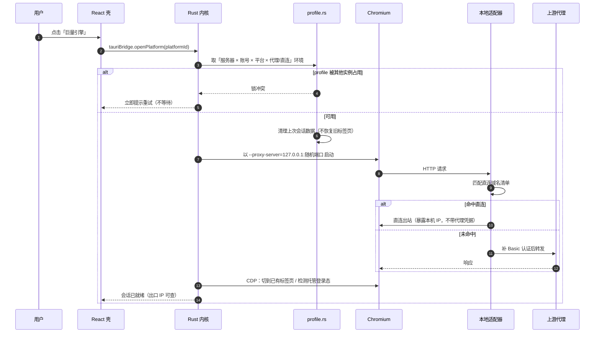

**缝价值**：壳只发一个命令，profile / 代理 / CDP 三个模块的协作完全不可见；分流出站规则由管理员
在服务端配置，客户端没有手工填代理的入口。

---

## 8. 时序 C：活动采集与可靠上报

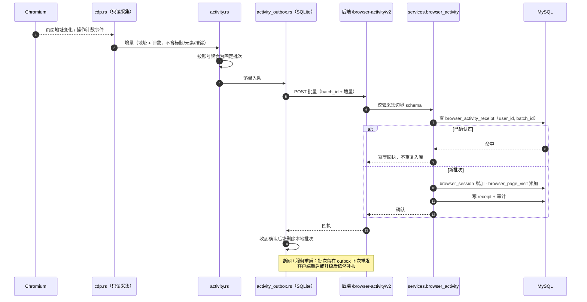

**缝价值**：客户端 outbox 与服务端 receipt 各自负责一侧，"至多丢一次、绝不重复入库"。
`session_key` 只在单个用户内唯一，服务端按 `(user_id, session_key)` 归并同一轮浏览器。

---

## 9. 时序 D：托管登录与失效恢复

管理员替用户保管平台凭据，用户点开平台就是已登录状态——这是产品最主要的价值点，也是风险最集中的一段。

```mermaid
sequenceDiagram
    autonumber
    participant ADM as 超级管理员
    participant API as 后端
    participant W as ManagedRecoveryWorker
    participant DB as MySQL
    participant R as Rust 内核
    participant C as Chromium

    ADM->>API: 保存方舟账号密码 / Cookie（仅超管可读写）
    API->>DB: managed_platform_account（credential_version+1）
    API->>DB: managed_platform_binding（用户 × 平台 × 账号）
    Note over ADM,DB: 凭据不进 desktop-config 的通用响应，不在 React 中出现

    用户点击平台
    R->>API: 申请一次性票据
    API->>DB: 校验绑定状态 / 账号状态 / 版本 / 有效期
    API->>DB: 写 managed_browser_session（grant_hash 唯一）
    API-->>R: 一次性 grant
    R->>C: 启动 about:blank
    R->>C: 注入 Cookie → 导航业务 URL
    R->>C: managed_cdp 检测登录态
    alt 会话有效
        R-->>用户: 直接进入业务首页
    else 检测到失效 / 挑战
        R->>API: 上报 session_status=invalid
        W->>DB: 抢租约（recovery_lease_token）
        W->>W: 服务端登录（Playwright 表单识别）
        alt 登录成功且身份匹配
            W->>DB: 会话恢复 valid，记 last_recovered_at
        else 验证码 / MFA / 结构不匹配
            W->>DB: 明确置为需人工处理，不绕过风控
        end
    end
```

边界说明（写进交付材料的必须原样保留）：**本地注入方案只能"隐藏"凭据，不能保证凭据不可获取**。
客户完全控制本机时，仍可从 profile、DevTools 或修改客户端取得会话。若验收要求"客户即使有技术能力
也拿不到会话"，需要走服务端远程浏览器方案，见
[巨量方舟托管登录设计](design/2026-11-02-巨量方舟托管登录设计.md)。

---

## 10. 数据模型

只画主干与关键约束，字段级说明见模型文件的 docstring。

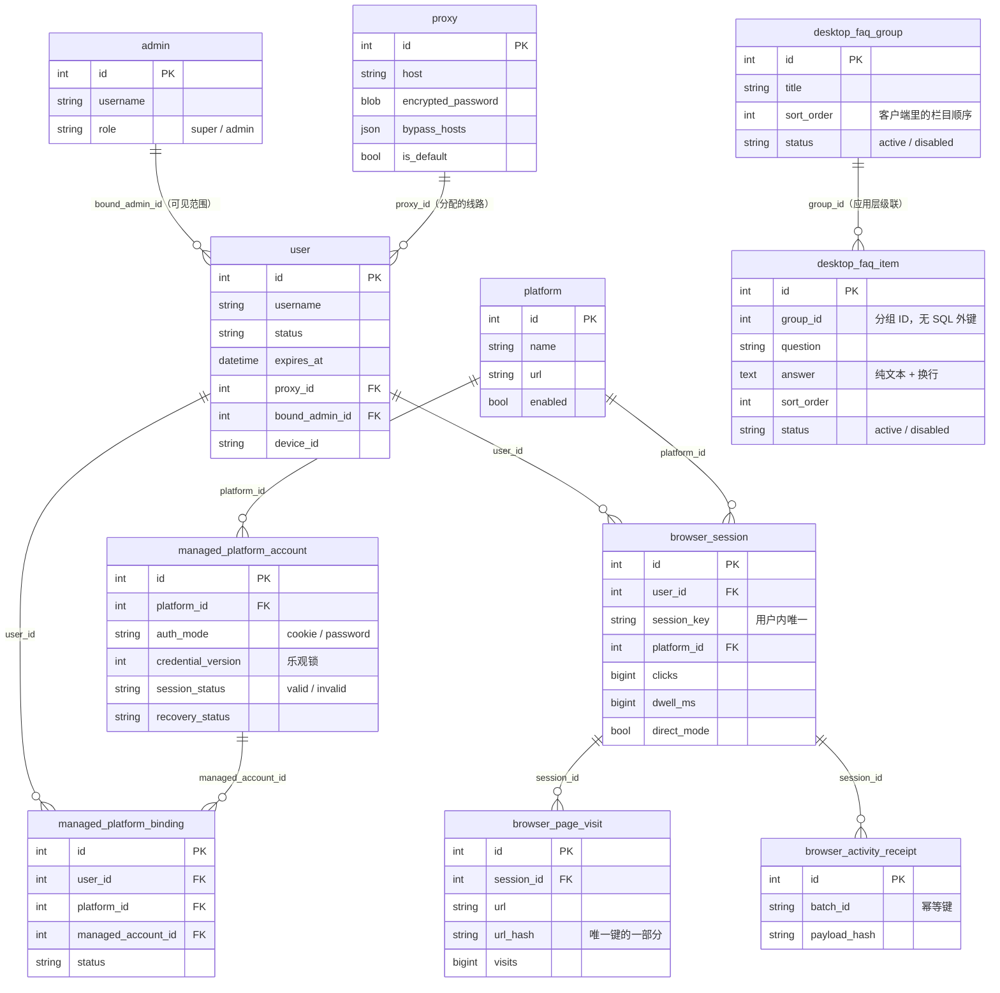

设计要点：

- `browser_session` 上的累计值是**有意的反范式**：管理端列表页不 join 明细表。
- `browser_page_visit` 的唯一约束挂在 `url_hash` 上，因为 URL + query 会超出 InnoDB 索引键长度。
- `credential_version` 是乐观锁：并发轮换凭据时，陈旧事务不能覆盖新凭据。
- `desktop_faq_*` 走「整篇替换」：管理端保存时在单事务里删掉全部旧行再写入，所以两张表没有 SQL 外键，
  删组即删条目；客户端只收到启用的行，空分组不会下发。
- `user_log` / `system_setting` / `uploaded_file` 为单体附属表，为图表可读性省略。

---

## 11. 部署拓扑（单机）

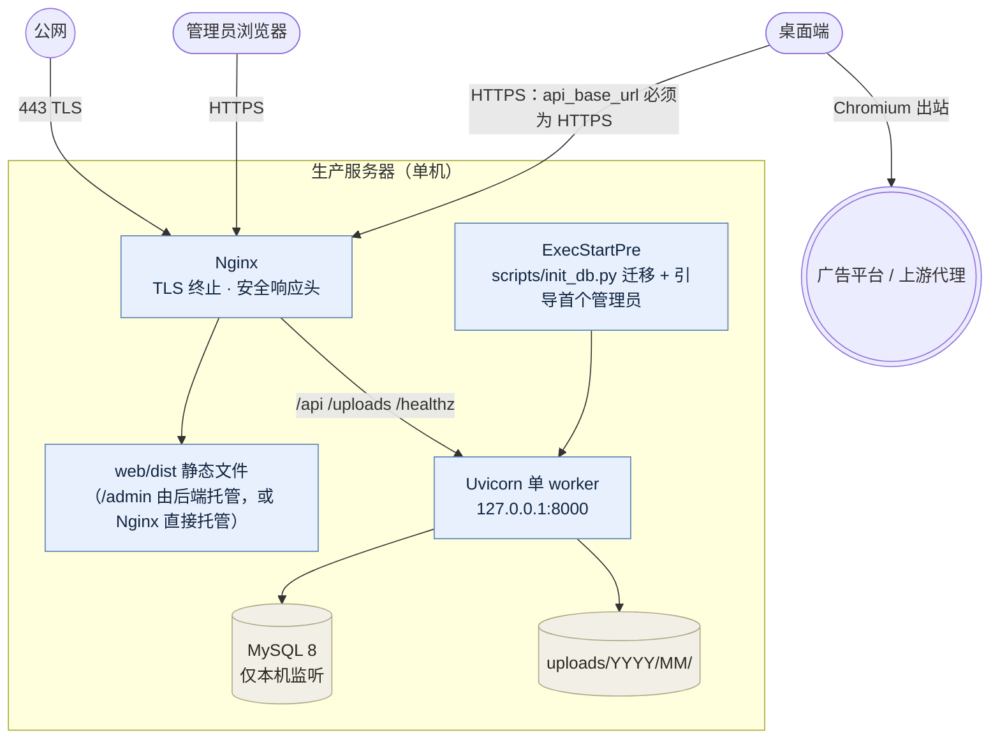

两种静态托管布局，二选一：

| 布局 | Nginx 行为 | 适用 |
| --- | --- | --- |
| 合并（默认） | 全量反代给后端，管理端走 `/admin` 路由 | 最简单，单域名 |
| 拆分 | Nginx 直接吃 `web/dist` 作为静态根，后端只收 `/api`、`/uploads`、`/healthz` | 前端可独立发版 |

**单 worker 是故意的**：多进程会并发建表并重复引导第一个管理员。
`--forwarded-allow-ips=127.0.0.1` 只信任本机 Nginx，否则 `X-Forwarded-*` 可被任意来源伪造。
完整步骤见 [deploy-linux.md](deploy-linux.md)。

---

## 12. 发布流水线

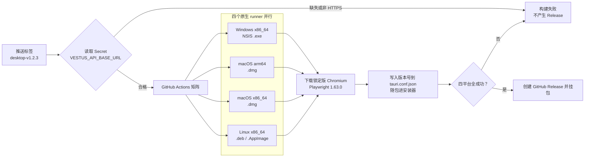

随包 Chromium 不能跨平台也不能跨架构，因此必须每个目标在对应 runner 上原生构建。
手工触发同一工作流则只构建、不发版，产物留在该次 Actions 的 Artifacts（保留 14 天）。

---

## 13. 约束总表

这些不是文档里的建议，是 CI 里会红的断言：

| 约束 | 强制手段 | 违反后果 |
| --- | --- | --- |
| 后端分层单向 | `lint-imports`（6 条契约） | 反向 import 直接失败 |
| 只有 service 提交事务 | 代码评审 + 分层契约 | repository 出现 `commit()` 即被指出 |
| 响应只有一种形状 | `install_openapi_envelope` + `tests/envelope.py` | 测试按信封断言 |
| 壳只能走 IPC 缝 | `check-surface-boundaries.mjs` | CI 静态检查失败 |
| 采集通道只读 | 上述静态检查 + `cdp.rs` 单测 | 采集获得写能力即失败 |
| 迁移无分叉 | 迁移测试对账 head 唯一且编号最大 | 漏挂 `down_revision` 被拦下 |
| 发布必须 HTTPS | `release.yml` 前置校验 | 拒绝发布不可登录的包 |

其余质量门禁（`make check` = ruff → mypy → import-linter → pytest）；真实浏览器持久化验收单独执行
`npm run test:persistence`，缺浏览器时**失败而不是跳过**，见
[browser-persistence-testing.md](browser-persistence-testing.md)。
